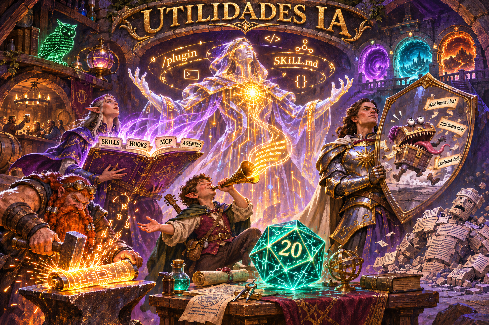
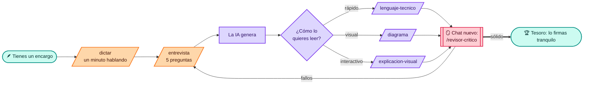

<div align="center">



<h1>Utilidades IA</h1>

<h3><i>El grimorio que convierte a tu IA de aprendiz con túnica a archimaga con presupuesto</i></h3>

<a href="#instalacion"></a>


<br>


</div>

<br>

> [!NOTE]
> 🪬 **Claude ya es listo. Con estos plugins, además, lanza conjuros.**
> Skills, subagentes, hooks y MCP que se equipan con un `/plugin` y funcionan a la primera (palabra de dev, juramento de enano).
> Menos pelearte con prompts y más dejar que la IA sude la armadura por ti.
> Aquí no entra relleno: si un objeto no es mágico de verdad, no cruza la puerta de la taberna.


## 🕯️ Prólogo del Dungeon Master

*Tira 1d20 por Sabiduría. ¿Ya? Da igual: te lo cuento igualmente.*

Érase una vez un aventurero que le pedía cosas a su IA con frases de una línea.
La IA, que es muy servicial, rellenaba los huecos **inventándose cosas**.
El aventurero leía tres muros de texto, asentía sin entender nada y firmaba la propuesta.
La IA le decía que estaba *"genial, muy completa y bien estructurada"*.

Era un **Mímico Adulador**. Se lo comió entero. 🦴

Este repositorio existe para que eso no te pase a ti. Aquí guardo las utilidades de IA que voy descubriendo y forjando: **skills, comandos, subagentes, hooks y servidores MCP**, empaquetados como plugins listos para equipar.


<a id="instalacion"></a>

## 🗝️ Tirada de iniciativa (instalación)

Cada reino tiene sus costumbres. Elige el tuyo y despliega el pergamino.

> [!TIP]
> **Leyenda del mapa:** **App** = aplicación de escritorio o móvil · **Chat** = la web en el navegador · **CLI** = el agente de terminal.

<details open>
<summary><b>🟠 Reino de Claude</b> · <i>la experiencia completa, con todos los conjuros, familiares e invocaciones</i></summary>

<br>

**⌨️ CLI · Claude Code** (también vale la pestaña *Code* de la app de escritorio). Aquí funciona **todo**: skills, comandos, subagentes y hooks.

```
/plugin marketplace add tonipp77/Utilidades-IA
/plugin install mejores-respuestas@utilidades-ia
```

Para recibir novedades: `/plugin marketplace update utilidades-ia`.

**🪟 App y 🌐 Chat · claude.ai** (escritorio, web y móvil comparten tus skills):

1. Descarga el ZIP de la skill que quieras desde el [Catálogo](#catalogo).
2. Ve a **Personalizar › Skills › `+` › Crear skill › Subir una skill** y sube el ZIP.
3. Comprueba en **Ajustes › Capacidades** que *Ejecución de código y creación de archivos* está activado. Sin eso, las skills no arrancan.
4. Úsala pidiéndolo con tus palabras (*"dibújame un esquema de…"*). Claude la activa solo.

</details>

<details>
<summary><b>🟢 Imperio de ChatGPT</b> · <i>skills en la app y en el chat; Codex en la terminal</i></summary>

<br>

**🪟 App y 🌐 Chat · chatgpt.com**

1. Descarga el ZIP de la skill desde el [Catálogo](#catalogo).
2. Ve a **Skills › Crear › Subir desde tu ordenador** y súbelo.
3. ChatGPT la analiza antes de activarla. En cuentas de empresa, el administrador debe permitir subir skills.

**⌨️ CLI · Codex**

Copia las skills en tu carpeta de skills de Codex.

Windows (PowerShell):

```powershell
git clone https://github.com/tonipp77/Utilidades-IA.git "$env:TEMP\Utilidades-IA"
New-Item -ItemType Directory -Force "$HOME\.codex\skills" | Out-Null
Copy-Item -Recurse -Force "$env:TEMP\Utilidades-IA\plugins\mejores-respuestas\skills\*" "$HOME\.codex\skills\"
```

macOS / Linux:

```bash
git clone https://github.com/tonipp77/Utilidades-IA.git /tmp/Utilidades-IA
mkdir -p ~/.codex/skills && cp -R /tmp/Utilidades-IA/plugins/mejores-respuestas/skills/* ~/.codex/skills/
```

Invócalas con `$diagrama`, `$entrevista`… o deja que Codex las active solo.

</details>

<details>
<summary><b>🔵 Archipiélago de Gemini</b> · <i>skills en la web y la app de Mac; CLI con un comando</i></summary>

<br>

**🌐 Chat · gemini.google.com** y **🪟 App de Mac**

1. Descarga el ZIP de la skill desde el [Catálogo](#catalogo) y descomprímelo.
2. Ve a **Ajustes › Skills › Subir** y sube la carpeta (o su `SKILL.md`). El nombre de la carpeta debe coincidir con el de la skill.
3. En el móvil verás las skills que ya hayas subido; las skills con archivos de apoyo solo se suben desde la web o la app de Mac.

**⌨️ CLI · Gemini CLI**

```
gemini skills install https://github.com/tonipp77/Utilidades-IA.git --path plugins/mejores-respuestas/skills
```

Añade `--scope workspace` si solo las quieres en el proyecto actual. Reinicia Gemini CLI después.

</details>

### 🪤 ¿Qué funciona en cada reino?

| Componente | Claude Code | Claude app/chat | ChatGPT app/chat | Codex CLI | Gemini app/chat | Gemini CLI |
|---|:-:|:-:|:-:|:-:|:-:|:-:|
| **Skills** (los conjuros) | 🫡 | 🫡 | 🫡 | 🫡 | 🫡 | 🫡 |
| **Comandos `/`** | 🫡 | 🪦 | 🪦 | 🪦 | 🪦 | 🪦 |
| **Subagentes** (invocaciones) | 🫡 | 🪦 | 🪦 | 🪦 | 🪦 | 🪦 |
| **Hooks** (glifos custodios) | 🫡 | 🪦 | 🪦 | 🪦 | 🪦 | 🪦 |

<sub>🫡 a sus órdenes · 🪦 aquí descansa en paz. Fuera de Claude Code, lo esencial (las skills) funciona igual; solo pierdes los extras de terminal.</sub>


<a id="catalogo"></a>

## 🍺 La Taberna (catálogo)

Objetos mágicos disponibles. Todos identificados, ninguno maldito (que sepamos).

| Objeto | Rareza | Qué hace | ZIP para apps |
|---|---|---|---|
| [**mejores-respuestas**](plugins/mejores-respuestas) |  | Seis conjuros para sacar mejores respuestas de la IA: mejor entrada, mejor salida y mejor filtro. | [dictar](dist/mejores-respuestas/dictar.zip) · [entrevista](dist/mejores-respuestas/entrevista.zip) · [lenguaje-tecnico](dist/mejores-respuestas/lenguaje-tecnico.zip) · [diagrama](dist/mejores-respuestas/diagrama.zip) · [explicacion-visual](dist/mejores-respuestas/explicacion-visual.zip) · [revisor-critico](dist/mejores-respuestas/revisor-critico.zip) |

### 🦉 Ficha de personaje: *Mejores Respuestas*

<div align="center">

</div>

### 🪶 El Grimorio

| Conjuro | Escuela | Componentes | Efecto |
|---|---|---|---|
| **`/dictar`** | Evocación | **V** (Verbal. Literalmente: habla.) | Dictas un minuto de ideas caóticas y te devuelve un encargo ordenado, sin perder ni una migaja. |
| **`/entrevista`** | Adivinación | V, S | Antes de responder, te hace hasta 5 preguntas de una en una y con opciones. Adiós a los datos inventados. |
| **`/lenguaje-tecnico`** | Transmutación | M (un contrato de 40 páginas) | Convierte muros de texto en estilo manual de avión: frases cortas, una idea por frase, cero datos perdidos. |
| **`/diagrama`** | Conjuración | S | Invoca un diagrama de flechas en siete colores con leyenda. Los párrafos huyen despavoridos. |
| **`/explicacion-visual`** | Ilusión | V, S, M (un navegador) | Crea una mini-web interactiva o un vídeo con voz para entender algo y tirarlo después. |
| **`/revisor-critico`** | Abjuración | Concentración, **chat nuevo** | Intenta tumbar tu documento: máximo 3 fallos citados y justificados. Si es sólido, te lo dice sin inventar. |
| *Familiar:* Píldora del día | Encantamiento | Pasivo | Cada vez que abres Claude Code, te susurra un consejo. La mitad de los días, *"dicta, no escribas"*. |

### 🧌 Bestiario: lo que estos conjuros destruyen

```diff
- Gólem de Párrafos ........ CA 18 · Ataque: muro de texto (aturde 1d4 minutos)
+ Vulnerable a: /lenguaje-tecnico y /diagrama (daño x2)

- Mímico Adulador .......... CA 12 · Ataque: "¡Qué buena idea!" (encanta al lector)
+ Vulnerable a: /revisor-critico en un chat nuevo (muerte instantánea)

- Doppelgänger de Datos .... CA 15 · Ataque: cifra inventada con total seguridad
+ Vulnerable a: /entrevista (no puede inventar lo que ya le has contado)

- Limo del Prompt Vago ..... CA 8  · Ataque: "hazme una propuesta" (sin contexto)
+ Vulnerable a: /dictar (le entra más información en un minuto que en diez de teclear)
```

### 🗺️ La campaña completa




## 🫙 Anatomía de un objeto mágico

| Pieza | Equivalente en la mesa | Para qué sirve |
|---|---|---|
| **Skill** | 🪶 Conjuro del grimorio | Instrucciones y conocimiento que la IA activa sola cuando la situación lo pide. |
| **Comando** | 🗣️ Palabra de poder | Un `/atajo` para lanzar un flujo concreto cuando tú decidas. |
| **Subagente** | 🐦‍⬛ Invocación | Un compañero especializado al que la IA delega trabajo, con su propio contexto. |
| **Hook** | 🔮 Glifo custodio | Runa que se activa sola en un evento: al abrir sesión, antes de usar una herramienta… |
| **MCP** | 🌀 Portal | Conexión con otros planos: APIs, bases de datos, servicios externos. |

<details>
<summary><b>🏚️ Planos de la mazmorra (estructura del repo)</b></summary>

```
.claude-plugin/marketplace.json   → el registro del gremio (todos los plugins)
plugins/<plugin>/                 → cada objeto mágico, autocontenido
dist/<plugin>/<skill>.zip         → skills empaquetadas para las apps
scripts/empaquetar-skills.ps1     → la forja que genera esos ZIP
assets/                           → ilustraciones del bestiario
```

</details>


## ⚒️ Únete al gremio

¿Tienes un objeto mágico que merece estar aquí? Abre un issue o un PR.

1. Forja tu plugin en `plugins/<nombre-plugin>/`.
2. Regístralo en `.claude-plugin/marketplace.json`.
3. Escribe su `README.md` y añádelo a la Taberna de arriba.
4. Regenera los ZIP: `pwsh ./scripts/empaquetar-skills.ps1`.
5. Valida con `claude plugin validate .` y pruébalo instalándolo en local.

**Código del Gremio:** nada de relleno, nada de secretos en el repo y nada que no hayas probado tú mismo. Las reglas completas están en [AGENTS.md](AGENTS.md), escritas para agentes de IA, pero los humanos también saben leer (algunos).

> [!WARNING]
> **No bebas pociones de desconocidos.** Los plugins ejecutan código y pueden acceder a tu sistema. Revisa lo que instalas, sobre todo hooks y servidores MCP.

<div align="center">

<br>

**Licencia [MIT](LICENSE)** · Hechizo de libre uso: cópialo, modifícalo y lánzalo donde quieras.

<sub>Forjado entre tiradas de dados y cafés por un dev .NET que habla con agentes. Si has llegado hasta aquí, ganas 50 PX. 🫎</sub>

</div>
